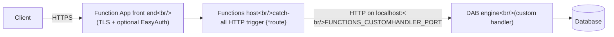

# Run Data API builder in an Azure Function App

This sample hosts Data API builder (DAB) in an Azure Function App using an
[Azure Functions custom handler](https://learn.microsoft.com/azure/azure-functions/functions-custom-handlers).
The Functions host starts the DAB engine as a child process and forwards every HTTP request to it, so
the REST, GraphQL and MCP endpoints behave the same as in any other DAB deployment.

## How it works



1. [`host.json`](./host.json) registers the self-contained DAB engine (`engine/Azure.DataApiBuilder.Service`) as the
   custom handler, sets `enableForwardingHttpRequest` to `true` so the original request is passed through
   unchanged, and sets `routePrefix` to `""` so DAB's paths (`/api`, `/graphql`, `/mcp`, `/health`) are not
   prefixed with the Functions default `/api`.
2. [`dab/function.json`](./dab/function.json) declares a single anonymous HTTP trigger with the catch-all route
   `{*route}`, so every path and method reaches DAB.
3. The Functions host sets `FUNCTIONS_CUSTOMHANDLER_PORT`. When that variable is present, DAB:
   - binds Kestrel to `http://localhost:<port>`, overriding `ASPNETCORE_URLS`
     ([`Program.cs`](../../src/Service/Program.cs#L515));
   - disables HTTPS redirection, because TLS is already terminated by the Function App front end
     ([`Program.cs`](../../src/Service/Program.cs#L515), [`Startup.cs`](../../src/Service/Startup.cs#L892));
   - uses that port for its internal health check client
     ([`PortResolutionHelper.cs`](../../src/Service/Utilities/PortResolutionHelper.cs#L27)).

   Detection is implemented in
   [`AzureFunctionsCustomHandlerHelper.cs`](../../src/Service/Utilities/AzureFunctionsCustomHandlerHelper.cs#L32).

## Requirements

- A **Linux** Function App on the Functions v4 runtime with `FUNCTIONS_WORKER_RUNTIME` = `custom`.
- A hosting plan that supports custom handlers, for example Dedicated (App Service plan) or Elastic Premium.
  Check the [hosting plan comparison](https://learn.microsoft.com/azure/azure-functions/functions-scale) for
  the current custom handler support of each plan before choosing Consumption or Flex Consumption.
- Build tools: .NET SDK (see [`global.json`](../../global.json)), `zip`, and the
  [Azure CLI](https://learn.microsoft.com/cli/azure/) for deployment. Build on Linux, macOS or WSL so the engine
  keeps its executable bit in the zip.

## Files

| File | Purpose |
|------|---------|
| [`host.json`](./host.json) | Custom handler registration, request forwarding and empty route prefix. |
| [`dab/function.json`](./dab/function.json) | Catch-all HTTP trigger. |
| [`dab-config.json`](./dab-config.json) | Sample DAB config. Reads the connection string from the `DATABASE_CONNECTION_STRING` app setting and uses the `AppService` (EasyAuth) provider. |
| [`local.settings.sample.json`](./local.settings.sample.json) | Template for local runs with Azure Functions Core Tools. Copy to `local.settings.json`. |
| [`build.sh`](./build.sh) | Publishes a self-contained engine to `engine/` and creates `dist/dab-function-app.zip`. |
| [`azure-functions-deploy.sh`](./azure-functions-deploy.sh) | Creates the Azure resources and deploys the zip. |

## Build

```bash
./build.sh
```

Optional variables: `RUNTIME_IDENTIFIER` (default `linux-x64`), `CONFIGURATION` (default `Release`) and
`DAB_CONFIG_FILE` (default `./dab-config.json`).

## Run locally with Azure Functions Core Tools

```bash
cp local.settings.sample.json local.settings.json
```

Edit `DATABASE_CONNECTION_STRING` in `local.settings.json`, then:

```bash
./build.sh
```

```bash
func start
```

The sample config uses `"mode": "production"` with the `AppService` provider, which requires
`WEBSITE_AUTH_ENABLED=True`. For a local run, either switch `host.mode` to `development` or change the
authentication provider. See
[`AppServiceAuthenticationInformation.cs`](../../src/Core/AuthenticationHelpers/AppServiceAuthenticationInformation.cs#L17).

## Deploy to Azure

```bash
./azure-functions-deploy.sh
```

The first run creates a `.env` file. Fill in `RESOURCE_GROUP`, `LOCATION`, `STORAGE_ACCOUNT`,
`FUNCTION_APP_NAME`, `PLAN_SKU` and `DATABASE_CONNECTION_STRING`, then run the script again.

After deployment, enable
[App Service Authentication](https://learn.microsoft.com/azure/app-service/overview-authentication-authorization)
on the Function App. The platform then injects the `X-MS-CLIENT-PRINCIPAL` header and sets
`WEBSITE_AUTH_ENABLED=True`, both of which DAB's `AppService` provider relies on. Alternatively, switch the
config to the `EntraID` (JWT) provider.

## Limitations

- **Request duration** is bounded by the Function App `functionTimeout` (see
  [host.json reference](https://learn.microsoft.com/azure/azure-functions/functions-host-json#functiontimeout))
  and the plan's HTTP limit.
- **WebSockets** are not forwarded by the Functions host, so GraphQL subscriptions are not available.
- **CORS**: configure CORS in either the Function App platform settings or `runtime.host.cors` in
  `dab-config.json`, not both, to avoid duplicate headers.
- **`/health`** follows the normal DAB rules: in production mode it is only returned to the roles listed in
  `runtime.health.roles`.
- **Cold start** includes DAB reading database metadata; the Functions host waits for the handler to start
  listening before forwarding requests.
